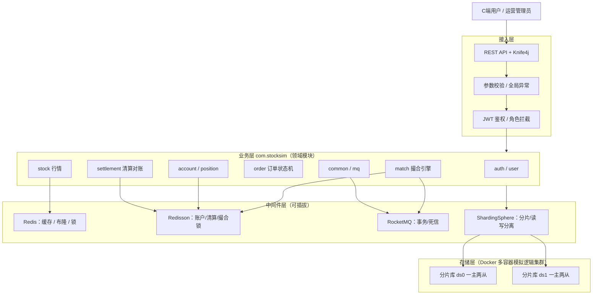
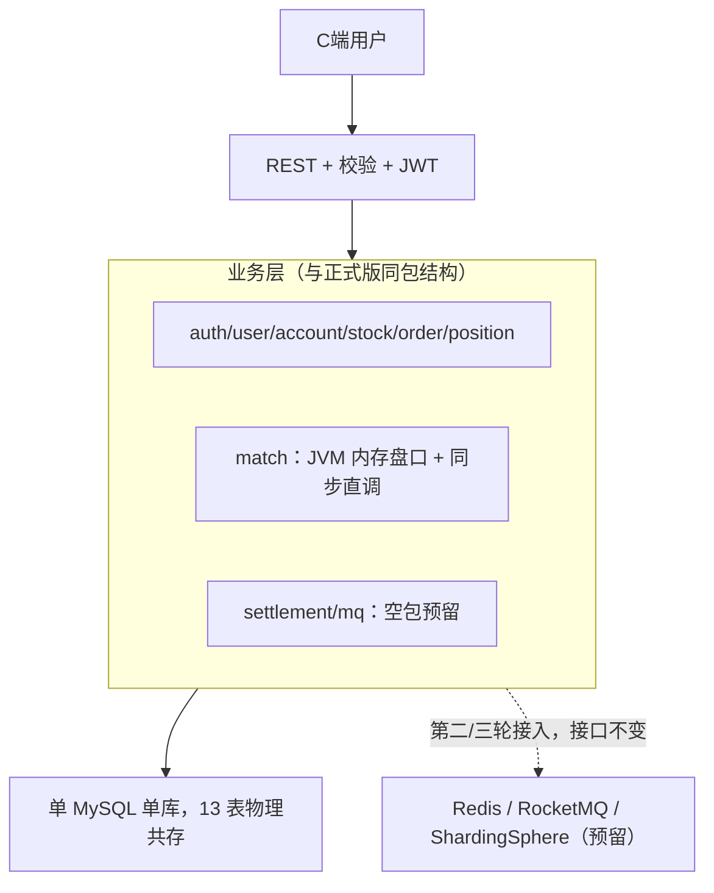

# 02 架构设计

## 一、设计原则
1. **单体架构 + 分布式中间件**：一个 Spring Boot 应用按领域分包，中间件可插拔，不做微服务拆分
2. **四层单向依赖**：接入层 → 业务层 → 中间件层 → 存储层，不反向、不跨层；业务层不直接出现中间件 API，全部收敛在接口实现类中
3. **面向接口、一次到位**：第一轮即按正式版包结构建工程，撮合盘口、成交回报、数据访问面向接口编程，后续仅替换实现、不改上层逻辑
4. **同库事务优先**：能用单库本地事务保证的不用分布式事务；跨用户/跨库链路用消息最终一致 + 日终对账兜底
5. **本地可模拟**：主从/分片拓扑用本地 Docker 多容器模拟，不要求多机物理部署

## 二、技术选型
| 分类 | 组件 | 版本 | 核心用途 / 选型依据 |
|------|------|------|---------------------|
| 基础环境 | JDK | 17 | LTS，Spring Boot 3.x 最低要求 |
| 核心框架 | Spring Boot | 3.2.11 | 3.x 成熟稳定分支，生态适配完善 |
| ORM | MyBatis-Plus | 3.5.7 | 单表 CRUD/分页；Boot 3 用 `mybatis-plus-spring-boot3-starter` |
| 关系数据库 | MySQL | 8.0.x | 事务/索引成熟，CHECK 约束（8.0.16+）兜底资金安全 |
| 分片组件 | ShardingSphere-JDBC | 5.5.x | 分库分表、读写分离；Boot 3 适配线 |
| 缓存 | Redis | 7.x | 缓存、分布式锁、幂等/选主（不承载撮合盘口） |
| 分布式锁 | Redisson | 3.25.0 | 可重入锁、看门狗续期，适配 Boot 3.2 |
| 消息队列 | RocketMQ 服务端 | 4.9.5 | 事务消息、死信队列，金融场景适配 |
| MQ 客户端 | RocketMQ Spring Starter | 2.3.1 | 适配 Boot 3（2.2.x 为 javax 老线） |
| 鉴权 | JJWT | 0.12.6 | 无状态 JWT，适配 Jakarta |
| 接口文档 | Knife4j | 4.4.0 | 适配 Boot 3 + SpringDoc 2（openapi3-jakarta） |
| 工具 | Hutool | 5.8.29 | 通用工具封装 |
| 监控 | Spring Boot Actuator | 随 Boot | 健康检查、指标暴露（内置，零额外成本） |
| 分布式 ID | 雪花算法（MP 内置） | - | 分片表全局唯一主键，趋势递增 |

**关键兼容口径（避坑）：**
- ShardingSphere **5.3+ 已移除 Spring Boot Starter**，Boot 3 下用 `shardingsphere-jdbc` + `ShardingSphereDriver` + 独立 YAML 接入（`spring.datasource.url=jdbc:shardingsphere:classpath:xxx.yaml`），不依赖 starter 自动装配
- RocketMQ **4.9.x 延迟消息仅 18 个固定等级**（1s~2h），不支持任意时间；订单当日有效，过期撤单由日终清算统一执行，不依赖任意延迟消息
- 雪花 ID 多实例部署须**显式分配 workerId**（默认按 MAC+PID 推导，容器环境 MAC 相同会冲突）

## 三、分层架构

### 正式版架构图


### 第一轮架构图（单库，无中间件）


### 业务包结构
```
com.stocksim
├── common       // 统一返回、异常、错误码、常量、幂等注解、雪花ID
├── auth         // 注册登录、JWT、角色拦截
├── user         // 个人信息维护
├── account      // 资金账户、冻结解冻、资金流水、乐观锁
├── stock        // 股票信息、模拟行情、行情查询
├── order        // 委托单、规则校验、状态机
├── match        // 盘口撮合、成交记录、成交回报
├── position     // 持仓增减、成本、盈亏、T+1
├── settlement   // 日终清算、对账、异常处理
└── mq           // 消息生产消费、事务消息、死信、幂等
```

## 四、数据存储架构（详见 [03-数据库设计](03-数据库设计.md)）
- **逻辑拓扑**：2 分片库 × 一主两从（**半同步复制**）；本地 docker-compose 一主一从即可演示
- **分片**：`trade_order`/`fund_flow`/`position_flow` 按 user_id 2库4表；`user_account`/`user_position` 按 user_id 2库1表，**与订单同库路由**（保证下单/记账同库本地事务）；`deal_order_daily` 与订单同库同算法（日终对账不跨库）；`deal_record` 单库按月分表；其余单表
- **读写分离**：写主读从；下单后即时查询等强一致场景 Hint 强制主库

## 五、分布式技术落地
1. **事务边界**：下单（订单+冻结+流水）、成交记账（订单+账户/持仓+流水+成交日汇总）均为**同库本地事务 + version 乐观锁**；RocketMQ 事务消息仅绑定「成交落库 → 成交通知」，事务回查兜底。下单冻结是前置同步条件，不做异步化
2. **成交记账拆分**：一笔成交含买卖双方（可能跨库），撮合落 `deal_record` 后发**买/卖两条记账消息**，消费端各自同库事务更新订单+账户/持仓+双侧流水（主流程+手续费各一条），并同事务 upsert `deal_order_daily` 日汇总；幂等键 `deal_no + user_id + 方向`，记账流水号按业务键确定性派生（成交/冻结/撤单全场景规则见 [03](03-数据库设计.md) §六.3），重放被片内 `uk_flow_no` 拦截、汇总不重复累加
3. **分布式锁**：Redisson 账户粒度锁（叠加乐观锁）、清算任务选主锁、撮合按 stock_code 串行锁
4. **缓存**：行情短 TTL + 定时主动刷新；股票基础信息长 TTL + 更新后失效；布隆过滤器防穿透、TTL 打散防雪崩；缓存仅加速，MySQL 为权威，整体失效可重建
5. **消息可靠性**：事务消息 + 持久化 + 死信队列 + 消费幂等；延迟消息仅用于固定等级的重试/延迟复核

## 六、撮合引擎设计与集群冗余
- **内存撮合为主路**：盘口始终在 JVM 内存（TreeMap 价格排序 + 同价 FIFO），`OrderBook` 接口隔离实现。**不迁移 Redis 盘口**——主流交易系统撮合均为内存单线程计算，热路径不走网络存储；Redis 仅做缓存/锁/选主
- **DB 即顺序日志**：`trade_order`（委托）+ `deal_record`（成交，全局 deal_seq）构成权威事件日志，本质是简化版事件溯源；盘口可丢，启动/故障按序重放未完结单重建（秒级 RTO）
- **串行撮合**：同一股票单线程串行，杜绝并发重复成交；集群按 stock_code 分片，每股单活 + Redisson 选主锁
- **序号与扩展**：deal_seq 单机 AtomicLong（启动取 DB max，走 uk_deal_seq 索引），集群 Redis INCR；远期主备热备（备机消费同一日志）与 Disruptor 无锁化见[附录](附录-高性能撮合演进.md)，不在当前范围

## 七、部署与集群演进
| 阶段 | 应用 | 撮合 / 清算 | 中间件 | 存储 |
|------|------|-------------|--------|------|
| 第一轮 | 单实例 | 内存撮合，同步直调 | 无 | 单 MySQL |
| 第二轮 | 单实例 | 内存撮合 + MQ 异步记账 | Redis 单机、RocketMQ 单 broker | 单 MySQL |
| 第三轮 | 单实例 | 同上 | 同上 | 2 分片库，每片一主一从（半同步复制） |
| 集群扩展 | 无状态多实例 + Nginx | 撮合按股票分片单活、清算选主单活 | Redis 哨兵、RocketMQ 多主多从 | 一主两从半同步 + MHA/Orchestrator |

应用无状态（JWT）天然支持水平扩容；有状态组件（撮合、清算）单活 + 锁选主，为集群预留冗余空间。

**可用性口径**：MySQL 半同步复制保证主库故障不丢已提交资金事务（RPO≈0）；主从切换 MHA/Orchestrator（RTO 数十秒，demo 手动切从）；撮合节点故障重启重放重建（RTO 秒级），期间该股票暂停撮合、不丢单。

## 八、平滑演进映射
| 分层 | 第一轮 | 正式版 | 扩展方式（不改上层） |
|------|--------|--------|----------------------|
| 撮合盘口 | 内存盘口（单实例） | 内存盘口（按股票分片多实例 + 主备） | `OrderBook` 接口，始终内存实现 |
| 成交回报 | 同步直调 | RocketMQ 异步 + 幂等 | `DealNotify` 接口替换为 MQ 生产者 |
| 账户并发 | DB 乐观锁 | 乐观锁 + Redisson 锁 | 叠加锁切面 |
| 数据访问 | 单数据源 | ShardingSphere 分片 + 读写分离 | 数据源层替换，SQL 不变 |
| 物理存储 | 单库 13 表 | 2 分片库一主两从 | 逻辑表名不变，加分片规则 |
| 行情读取 | 直接查库 | Redis 缓存 + 布隆 | Repository 下增缓存实现 |

**三条硬性保障**：① 分层依赖不破坏；② 分片键第一轮提前落位（user_id/deal_time），后续不改表、不迁数据；③ 状态机与表结构以第一轮为基线冻结，后续只加中间件与路由。

## 九、可观测性与测试
- **可观测**：Actuator 健康/指标；日志统一 traceId（MDC）；下单/成交/清算关键链路打点
- **测试**：单元（状态机、成本计算）+ 集成（四条验收链路）+ JMeter 压测（TPS 指标）+ 对账校验

## 十、与主流交易系统对比
| 维度 | 主流交易系统 | 本设计 | 结论 |
|------|--------------|--------|------|
| 撮合 | 内存单线程 + 事件溯源 + 快照 | 内存单线程 + DB 顺序日志重放 | 对齐（简化版事件溯源） |
| 前端风控 | 下单前验资验券冻结 | 同库事务冻结 + 规则校验 | 对齐 |
| 撮合规则 | 价格时间优先、T+1、涨跌停 | 同 | 对齐 |
| 清算 | 交易与清算分离、日终批量 | settlement 独立模块 | 对齐 |
| 一致性 | 双侧流水 + 对账兜底 | 同 | 对齐 |
| 持久化 | 半同步/MGR、多副本 | 半同步主从 + 分片 | 对齐（demo 降级一主一从） |
| 热备秒切 | 撮合主备热切换、价格笼子、逐笔风控 | 重启重建（秒级 RTO） | 生产增强项，demo 不引入以免过度复杂 |