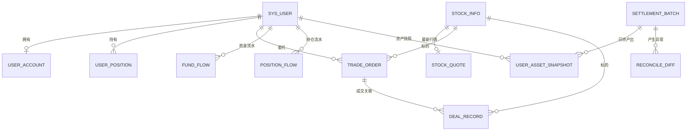

# 03 数据库设计

## 一、设计目标与原则
面向系统**完整生命周期**而非仅第一轮单库开发：
1. **需求全覆盖**：五大业务中心、四条验收链路、选做扩展均有表承载
2. **账实可追溯**：资金/持仓双侧流水只追加不可变；成交、订单、流水三方可对账，异常落库、人工兜底有记录
3. **分片键前置**：需分片的表第一轮即带分片键与索引，后续加分片规则不改表、不迁数据
4. **同库事务**：账户/持仓与订单同分片键同库路由，下单与记账走单库本地事务，避免跨库分布式事务
5. **乐观锁与幂等内建**：强一致表内建 version；流水类表内建唯一流水号承担消费幂等
6. **约束兜底**：资金/持仓/订单用 CHECK 约束保证非负与勾稽关系（MySQL 8.0.16+ 强制生效）

### 通用字段约定
| 约定项 | 口径 |
|--------|------|
| 主键 | `BIGINT` 雪花全局唯一，不用自增（分片表无法保证全局唯一） |
| 价格 | `DECIMAL(18,4)`；A股报价两位小数，预留四位 |
| 金额 | `DECIMAL(20,2)`；计算统一 **HALF_UP 四舍五入到分** |
| 数量 | `BIGINT`（股）；比率 `DECIMAL(10,4)` |
| 涨跌停价 | 昨收 × (1±幅度)，**四舍五入到分**后落库 |
| 时间 | `DATETIME(3)` 毫秒精度 |
| 审计字段 | `create_time` / `update_time`；逻辑删除 `deleted TINYINT DEFAULT 0` |
| 乐观锁 | `version INT DEFAULT 0`，仅强一致表 |
| 流水类表 | 只追加，不设 `update_time`/`deleted`，应用层禁止 UPDATE/DELETE |
| 唯一键 | 业务唯一键不含 deleted；用户注销时将 username 追加后缀释放占用，避免唯一键冲突 |

---

## 二、表清单总览（16 张：核心 12 + 扩展 4）
| 域 | 表名 | 用途 | 类别 | 分片/高可用策略 |
|----|------|------|------|----------------|
| 用户权限 | `sys_user` | 用户与管理员统一账号 | 核心 | 单表 |
| 行情 | `stock_info` | 股票基础信息、涨跌停参数 | 核心 | 单表（低频变更） |
| 行情 | `stock_quote` | 每股最新行情 | 核心 | 单表，高频更新走缓存 |
| 行情 | `stock_price_tick` | 分时行情快照 | 扩展 | 按时间分表/冷归档 |
| 资金 | `user_account` | 余额、冻结、总资产 | 核心 | **按 user_id 2库1表，与订单同库** |
| 资金 | `fund_flow` | 资金流水（对账根基） | 核心 | 按 user_id 2库4表 |
| 持仓 | `user_position` | 持仓、成本、T+1、盈亏 | 核心 | **按 user_id 2库1表，与订单同库** |
| 持仓 | `position_flow` | 持仓变动流水 | 核心 | 按 user_id 2库4表 |
| 订单 | `trade_order` | 委托单与状态机 | 核心 | 按 user_id 2库4表 |
| 订单 | `order_status_log` | 订单状态变更追溯 | 扩展 | 单表，预留时间分表 |
| 成交 | `deal_record` | 撮合成交记录 | 核心 | 单库按月分表 |
| 清算 | `settlement_batch` | 日终清算批次 | 核心 | 单表，trade_date 唯一 |
| 清算 | `user_asset_snapshot` | 每日资产快照 | 核心 | 单表，预留 user_id 分片 |
| 清算 | `reconcile_diff` | 对账异常与人工处理 | 核心 | 单表 |
| 风控 | `risk_rule` | 风控规则配置 | 扩展 | 单表 |
| 系统 | `sys_operation_log` | 管理员操作与登录审计 | 扩展 | 单表，预留时间归档 |

---

## 三、核心 ER 关系

物理上**不建外键约束**（分库分表后外键失效，影响写入与故障恢复），关联由应用层保证；流水与订单通过 `biz_no` 软关联。

---

## 四、核心表字段设计（12 张）

### 1. sys_user 用户表
`id`、`username`(唯一)、`password`(BCrypt)、`nickname`、`phone`、`email`、`role`(1用户/2管理员)、`status`(1正常/0禁用/2注销)、`last_login_time`、`version`、审计字段。
索引：`uk_username`、`idx_phone`。

### 2. stock_info 股票基础信息表
`id`、`stock_code`(唯一)、`stock_name`、`market`(1沪/2深/3北)、`board_type`(1主板/2创业/3科创/4北交)、`issue_price`、`price_limit_ratio`(0.10/0.20/0.05)、`lot_size`(默认100)、`status`(1上市/0停牌/2退市)、`list_date`、`version`、审计字段。
索引：`uk_stock_code`。

### 3. stock_quote 最新行情表（与基础信息分离，避免高频更新干扰）
`id`、`stock_code`(唯一)、**`trade_date`**(交易日，日切重置依据)、`pre_close_price`、`open_price`、`latest_price`、`high_price`/`low_price`、`limit_up_price`/`limit_down_price`(冗余，下单校验直读)、`total_volume`、`total_amount`、`change_ratio`、`quote_time`、审计字段。
索引：`uk_stock_code`。
> 当日最高/最低/累计成交量按 `trade_date` 归属；日终清算做行情日切（见 [04](04-核心模块设计.md) settlement）。

### 4. user_account 资金账户表（一用户一账户）
`id`、`user_id`(唯一，**分片键**)、`account_no`(唯一)、`currency`(默认CNY)、`balance`、`frozen_amount`、`total_asset`(日终刷新)、`status`(1正常/0冻结/2注销)、`version`、审计字段。
可用资金统一口径 `available = balance - frozen_amount`，不物理冗余。
约束：`CHECK (balance >= 0 AND frozen_amount >= 0 AND frozen_amount <= balance)`。
索引：`uk_user_id`、`uk_account_no`。

### 5. fund_flow 资金流水表（只追加，对账根基）
`id`、`flow_no`(唯一，幂等键)、`user_id`(**分片键**)、`account_id`、`flow_type`(1入金/2出金/3冻结/4解冻/5买入扣款/6卖出入账/7手续费/8清算调整)、`change_balance`(正入负出)、`change_frozen`、`balance_before`/`balance_after`、`frozen_before`/`frozen_after`、`biz_type`(1订单/2成交/3清算/4人工)、`biz_no`、`remark`、`create_time`。
索引：`uk_flow_no`、`idx_user_time(user_id, create_time)`、`idx_biz_no`。

### 6. user_position 持仓表（用户 × 股票唯一）
`id`、`user_id`(**分片键**)、`stock_code`、`total_qty`、`frozen_qty`(卖出委托冻结)、**`today_buy_qty`**(当日买入，T+1 冻结，日终清零)、`cost_amount`、`avg_cost_price`、`latest_price`、`market_value`、`floating_pnl`、`pnl_ratio`、`version`、审计字段。
可用持仓口径 `available_qty = total_qty - frozen_qty - today_buy_qty`（T+1）。
约束：`CHECK (total_qty >= 0 AND frozen_qty >= 0 AND today_buy_qty >= 0 AND frozen_qty <= total_qty)`。
索引：`uk_user_stock(user_id, stock_code)`（左前缀已覆盖 user_id 查询，**不再单建 idx_user_id**）。
> 市值/浮盈查询时按最新行情实时计算，落库仅日终快照，避免高频行情全量刷持仓。

### 7. position_flow 持仓变动流水表（只追加）
`id`、**`flow_no`(唯一，幂等键)**、`user_id`(**分片键**)、`stock_code`、`change_type`(1买入/2卖出/3清算调整)、`change_qty`(正增负减)、`deal_price`、`total_qty_before`/`total_qty_after`、`cost_before`/`cost_after`、`biz_no`、`create_time`。
索引：`uk_flow_no`、`idx_user_stock_time(user_id, stock_code, create_time)`、`idx_biz_no`。

### 8. trade_order 订单表
`id`、`order_no`(唯一，幂等键)、`user_id`(**分片键**)、**`request_id`**(客户端幂等号，防重复提交)、**`trade_date`**(交易日，撤单/对账归属)、`stock_code`、`direction`(1买/2卖)、`order_type`(1限价/2市价预留)、`entrust_price`、`entrust_qty`、`matched_qty`、`frozen_amount`(买单冻结资金，含预估手续费)、`frozen_qty`(卖单冻结股数)、**`fee_amount`**(累计实际手续费)、`status`(1待撮合/2部分成交/3全部成交/4已撤单/5部分成交后撤单/6已过期)、`expire_time`、`reject_reason`、`source`、`version`、审计字段。
约束：`CHECK (entrust_qty > 0 AND matched_qty >= 0 AND matched_qty <= entrust_qty)`。
索引：`uk_order_no`、`uk_user_request(user_id, request_id)`、`idx_user_status_time(user_id, status, create_time)`、`idx_stock_status(stock_code, status)`。

### 9. deal_record 成交记录表（单库按月分表，不按用户分片）
`id`、`deal_no`(唯一)、`stock_code`、`deal_price`、`deal_qty`、`deal_amount`、`buyer_order_no`/`seller_order_no`、`buyer_user_id`/`seller_user_id`、`deal_seq`(撮合全局序号，可重放)、`deal_time`(**时间分表键**)。
索引：`uk_deal_no`、`idx_buyer_time`、`idx_seller_time`、`idx_stock_time`、`idx_buyer_order_no`、`idx_seller_order_no`。
> 一笔成交含买卖双方，无法按单一 user_id 分片，故按 `deal_time` 月分表、固定存于 ds0；用户查成交走 buyer/seller 双向索引 + 时间范围。

### 10. settlement_batch 清算批次表
`id`、`batch_no`(唯一)、`trade_date`(唯一，幂等重跑依据)、`status`(1执行中/2成功/3部分异常/4失败)、`total_user_count`、`diff_count`、`start_time`/`end_time`、`remark`、审计字段。
索引：`uk_batch_no`、`uk_trade_date`。

### 11. user_asset_snapshot 日终资产快照表
`id`、`user_id`(预留分片键)、`trade_date`、`cash_balance`、`market_value`、`total_asset`、`cost_amount`、`floating_pnl`、`pnl_ratio`、`create_time`。
索引：`uk_user_date(user_id, trade_date)`；重跑按 `(user_id, trade_date)` 幂等 upsert。

### 12. reconcile_diff 对账异常表
`id`、`batch_no`、`trade_date`、`user_id`、`diff_type`(1资金/2持仓/3订单状态)、`biz_no`、`expect_value`/`actual_value`、`status`(1待处理/2已处理/3误报关闭)、`handle_user_id`、`handle_remark`、`handle_time`、审计字段。
索引：`idx_status`、`idx_batch`、`idx_user_id`。

---

## 五、扩展表字段设计（4 张，随轮次启用）
13. **stock_price_tick**：`id`、`stock_code`、`price`、`volume`、`amount`、`tick_time`；`idx_code_time`；启用时按 tick_time 月分表冷归档。
14. **order_status_log**：`id`、`order_no`、`from_status`、`to_status`、`change_type`(1撮合/2用户撤单/3过期撤单/4清算)、`operator_id`、`remark`、`create_time`；`idx_order_no`。
15. **risk_rule**：`id`、`rule_code`(唯一)、`rule_name`、`rule_type`(1单笔限额/2单日累计/3单股持仓占比)、`threshold_value`、`status`、审计字段。
16. **sys_operation_log**：`id`、`operator_id`、`operator_name`、`operation_type`(1登录/2股票维护/3行情管理/4差错处理/5其他)、`target_type`、`target_id`、`detail`(JSON)、`ip`、`create_time`；`idx_operator_time`。

---

## 六、分库分表设计（ShardingSphere-JDBC 5.5.x）

### 1. 逻辑拓扑
- 2 分片逻辑库 `ds0`/`ds1`，每片一主两从、**半同步复制**；本地 docker-compose 一主一从即可演示读写分离与故障切换
- 分库算法 `user_id % 2`；分表算法各表自定（订单/流水每库 2 表 = 4 物理表，账户/持仓每库 1 表）

### 2. 分片规则明细
| 表 | 分片键 | 规则 | 设计理由 |
|----|--------|------|----------|
| trade_order | user_id | 2库4表 | 用户维度查询为主，同用户落同片 |
| fund_flow | user_id | 2库4表，与订单同算法 | 订单与资金流水同片，对账不跨库 |
| position_flow | user_id | 2库4表 | 持仓流水与用户同片 |
| user_account | user_id | **2库1表，与订单同库** | 下单冻结、成交记账同库本地事务 |
| user_position | user_id | **2库1表，与订单同库** | 同上，避免跨库事务 |
| deal_record | deal_time | 单库(ds0)按月分表 | 含买卖双方无法按用户分片；时间分表冷热分离 |
| user_asset_snapshot | user_id（预留） | 先单表 | 年量 = 用户数×250，预留分片键 |
| stock_price_tick | tick_time（预留） | 启用时按月分表 | 时序数据 |

> **同库事务是关键**：账户/持仓与订单同分片键同库路由后，「下单+冻结+流水」「成交记账+账户/持仓+流水」均为单库本地事务。成交涉及买卖双方跨库时，拆成两条记账消息各自同库事务（见 [02](02-架构设计.md) 第五节）。

### 3. 扩容与演进
- 第一轮单库：全部表物理共存于 `stock_sim`，表名字段与分片后完全一致
- 第三轮接入 ShardingSphere：仅替换数据源 + 配置分片规则，MyBatis-Plus 代码与 SQL 不变
- 分片数 2→4：倍增取模只迁半数数据，雪花 ID 无自增冲突

---

## 七、读写分离与高可用

### 1. 读写分离
- 写路由主库，读轮询从库；强一致场景（下单后即时查订单/余额、撮合重建读未完结单）用 ShardingSphere Hint 强制主库
- **半同步复制**（`rpl_semi_sync`）：至少一个从库确认收到 binlog 主库才返回提交，避免主库故障丢已提交资金事务（金融级底线，RPO≈0）；异步复制仅用于 demo 降级
- **本地用多容器真实主从**；单实例多 schema 仅用于第一轮分片逻辑预演，**不能模拟主从**（不同 schema 数据不会同步）
- 一主多从合理性：交易读多写少、读写分离摊薄主库压力、从库提供故障冗余；生产一主两从，本地一主一从足够；从库延迟超阈值临时摘除

### 2. 高可用要点
| 层级 | 机制 |
|------|------|
| MySQL | 半同步复制 + 主库故障切从（MHA/Orchestrator 口径），RPO≈0 |
| 撮合盘口 | 内存盘口 + 重启从 trade_order/deal_record 重放重建；DB 为权威，盘口可丢 |
| 消息 | 事务消息 + 持久化 + 死信队列 + 消费幂等 |
| 清算 | settlement_batch 状态机 + trade_date 唯一，中断按批次重跑，快照幂等 upsert |
| 备份 | 逻辑全量 + binlog 增量（PITR 口径），异地保存 |

### 3. 缓存协同
行情/股票信息读 Redis，未命中回源；布隆防穿透、TTL 打散防雪崩；更新采用「更新数据库 + 失效缓存」；缓存仅加速，MySQL 为权威。

---

## 八、索引设计规范
1. 分片键、唯一业务号（order_no/flow_no/deal_no）必建索引，唯一索引承担幂等
2. 列表查询按「等值列在前、排序/时间列在后」建联合索引
3. 金额/长文本不建普通索引；联合索引不超过 5 字段
4. 流水表索引 ≤3 个，写入优先；历史分表不加新索引，分析走归档库
5. 逻辑删除字段不单独建索引；联合索引左前缀已覆盖的不再单建（如 user_position 的 user_id）

---

## 九、数据一致性与可靠性
1. **账户/持仓/订单更新**：同库本地事务 + version 乐观锁 CAS + CHECK 约束兜底，失败重试由上层控制
2. **跨模块最终一致**：事务消息绑定「成交落库→成交通知」，回查兜底；消费端以 `deal_no+user_id+方向` 幂等
3. **双侧流水闭环**：每笔成交产出 deal_record + fund_flow（买卖各一）+ position_flow（买卖各一），日终三方互对，差异写 reconcile_diff
4. **流水不可变**：纠错追加冲正流水（flow_type=8），不改历史，保留审计轨迹
5. **日终对账兜底**：实时链路允许秒级最终一致，偏差当日在 reconcile_diff 闭环
6. **对账口径**：资金 `Σfund_flow.change_balance = account.balance`；持仓 `Σposition_flow.change_qty = position.total_qty`；订单 `matched_qty = Σ对应 deal_record.deal_qty`

---

## 十、分阶段落地
| 阶段 | 数据库动作 |
|------|-----------|
| 第一轮 | 单 schema 建全部 12 核心表；4 扩展表暂不建 |
| 第二轮 | 接入 Redis，表结构不变；启用 order_status_log、sys_operation_log |
| 第三轮 | 接入 ShardingSphere，账户/持仓/订单/流水按 user_id 分片、deal_record 按月分表；半同步主从读写分离 |
| 第四轮 | 跑通 settlement_batch→快照→reconcile_diff 全链路；按需启用 tick 分表与 risk_rule |

完整可执行 DDL 见 `sql/schema.sql`（核心）与 `sql/schema_ext.sql`（扩展），`CREATE TABLE IF NOT EXISTS` 可重复执行。