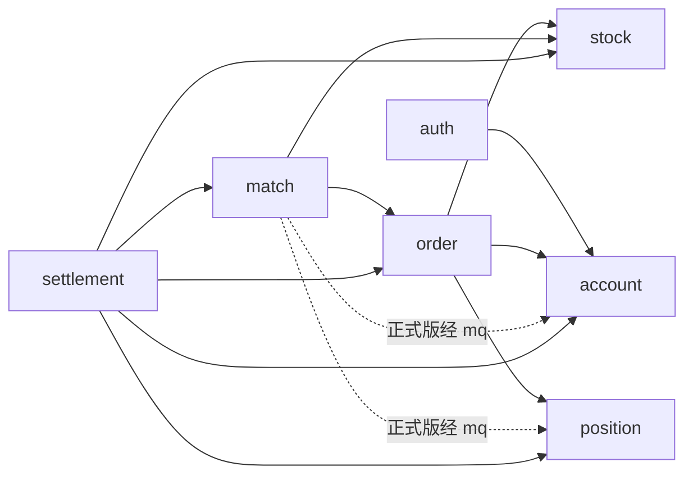

# 04 核心模块设计

> 口径对齐 [02-架构设计](02-架构设计.md) 的 10 个工程包与 [03-数据库设计](03-数据库设计.md) 的 17 张表；交易规则统一以 [01-需求与边界](01-需求与边界.md) 第三节为准。每模块只写职责、关键实现与依赖表。

## 一、模块总览

### 依赖关系

`common` 为公共底座、`mq` 为消息通道，不画入业务依赖；`user` 与 `auth` 平级共用 sys_user。第一轮 match 同步直调 account/position，正式版经 mq 异步。

### 模块—表—轮次对照
| 模块 | 一句话职责 | 主要依赖表 | 第一轮 |
|------|-----------|-----------|--------|
| common | 通用底座，无业务 | 无 | 是 |
| auth | 注册登录、JWT、角色拦截 | sys_user | 是 |
| user | 个人信息维护 | sys_user | 是 |
| account | 资金账户、冻结解冻、流水 | user_account、fund_flow | 是 |
| stock | 股票信息、模拟行情、查询 | stock_info、stock_quote | 是 |
| order | 委托单、规则校验、状态机 | trade_order、fund_flow、user_position、position_flow | 是 |
| match | 盘口撮合、成交记录、回报 | deal_record、trade_order | 是（内存版） |
| position | 持仓增减、成本、盈亏、T+1 | user_position、position_flow | 是 |
| settlement | 日终清算、对账、异常 | settlement_batch、user_asset_snapshot、reconcile_diff、deal_order_daily 等 | 否（第四轮） |
| mq | 消息生产消费、死信、幂等 | 无（RocketMQ 外部） | 否（第二轮） |

---

## 二、各模块简明设计

### 1. common
统一返回 `Result`、错误码枚举（见 [05](05-接口设计.md)）、`BizException` 与全局异常处理、常量、分页封装、幂等注解、雪花 ID 配置（多实例显式 workerId）、traceId（MDC）。只被依赖，不反向依赖业务。

### 2. auth
注册（用户名唯一校验、BCrypt、成功后调 account 开户）；登录（校验密码签发 JWT，含过期时间）；JWT 拦截器（白名单：登录/注册/Knife4j）；管理员接口按 role 简单拦截，不引入完整 RBAC。依赖 sys_user，调用 account。

### 3. user
个人信息查询与修改，与 auth 共用 sys_user，不涉及密码与鉴权。

### 4. account
一用户一账户；入金/出金、冻结/解冻、余额查询。入金/出金必传 `request_id`，按 `(user_id, request_id)` 幂等去重（HTTP 重试返回原流水结果）。每笔变动同库本地事务内 CAS 更新（version）+ 写 fund_flow（只追加，含前后余额/冻结额）；可用资金 `balance - frozen_amount`；CHECK 约束兜底非负与勾稽。手续费独立流水（flow_type=7）；卖出费用合计超过成交金额时按成交金额封顶（01 口径，保证余额非负约束恒成立）。依赖 user_account、fund_flow。

### 5. stock
股票信息维护（管理员）；`@Scheduled` 定时模拟行情：仅交易时段生成，基于 latest_price 随机游走（步长可配），约束在涨跌停价内，upsert stock_quote 并同步涨跌停价与 trade_date；第二轮加 Redis 短 TTL 缓存 + 布隆过滤器。依赖 stock_info、stock_quote。

### 6. order
**创建校验清单**：交易时段、股票上市状态（停牌/退市拒绝）、涨跌停、买入整手/卖出零股、T+1 可卖持仓、可用资金/可用持仓、账户状态正常、`request_id` 幂等（重复提交返回原单）。
**冻结口径**：买单冻结 = 委托价×数量 + 预估佣金（按委托价计，成交价≤委托价故实际费用≤预估）；卖单冻结持仓。冻结同事务写双侧流水（fund_flow 类型3 / position_flow 类型4），流水号按 `{order_no}F3`/`{order_no}P4` 派生。
**状态机**：待撮合→部分成交→全部成交/已撤单/已过期，version CAS 流转；撤单与撮合互斥（同股票串行 + 状态 CAS，冲突重试）。
第一轮仅系统自动撤单（日终，随 settlement），用户主动撤单第二轮；expire_time 第一轮取当日收盘时间。撤单/过期解冻写双侧流水（资金4/持仓5）。依赖 trade_order、fund_flow、user_position、position_flow。

### 7. match
**撮合**：买单最高价 ≥ 卖单最低价即成交，**成交价 = 对手方（先挂单方）委托价**；价格优先、时间优先。
**串行**：同一股票撮合串行（第一轮内存单线程；正式版 Redis Lua 原子撮合 / Redisson 股票粒度锁），杜绝并发重复成交。
**可靠性**：写 deal_record（带全局 deal_seq）为权威；启动/故障从 trade_order 未完结单重建盘口；deal_seq 单机 AtomicLong（启动取 DB max，走 uk_deal_seq 索引），集群 Redis INCR。
**回报**：第一轮同步直调 account/position；正式版落 deal_record 后发买/卖两条记账消息（事务消息绑定），消费端各自同库事务，并同事务 upsert deal_order_daily 日汇总（对账用，重放被 uk_flow_no 拦截不重复累加）。
**演进**：`OrderBook` 接口隔离实现，盘口始终内存（TreeMap+FIFO），不迁 Redis；DB 即顺序日志，集群按股票分片单活。依赖 deal_record、trade_order。

### 8. position
买入按加权平均更新成本（含买入费用），卖出按均价结转；T+1：买入成交 `today_buy_qty += qty`，可卖 = total - frozen - today_buy，日终清零 today_buy；version 乐观锁 + 每次变动写 position_flow（含冻结/解冻，类型4/5；卖出成交减仓同时解冻 frozen_qty）；市值/浮盈查询时按最新行情实时算，日终落库。依赖 user_position、position_flow。

### 9. settlement（第四轮）
**日终流程**（Redisson 选主锁，trade_date 批次幂等可重跑，settle_step 记录进度、中断从下一步续做）：
1. 收盘停止行情 → 2. 撤未成交/部分成交单并解冻资金/持仓（按 trade_date+status 索引扫描，状态 CAS 幂等）→ 3. 行情日切（pre_close=latest、重算涨跌停价、重置当日高低/量额、trade_date 推进至下一交易日）→ 4. T+1 解冻（today_buy_qty 清零）→ 5. 盈亏计算与资产快照（按 user_id+trade_date upsert，带 batch_no）→ 6. 三方对账 → 7. 差异落 reconcile_diff（按 uk_batch_user_type_biz 幂等 upsert，不重置已处理状态），人工闭环。
**对账口径**：资金 Σfund_flow.change_balance=account.balance 且 Σchange_frozen=frozen_amount；持仓 Σposition_flow.change_qty=position.total_qty 且 Σchange_frozen=frozen_qty；订单 matched_qty=Σdeal_order_daily.deal_qty、matched_amount=Σdeal_amount、fee_amount=fee_amount（三方均本库闭环）。deal_record 为权威成交明细，与日汇总的全量交叉核对走 T+1 离线归档任务，不做跨库在线 SQL。纠错追加冲正流水（flow_no 发号器生成，重跑按 settle_step + biz_no=批次号查重保证幂等），不改历史。依赖清算三表 + 订单/流水/成交日汇总。

### 10. mq（第二轮）
事务消息绑定「成交落库→成交通知」；消费端以 `deal_no+user_id+方向` 幂等；死信队列兜底；延迟消息仅用固定等级（4.9.x 限制）做重试/延迟复核。依赖 RocketMQ，无业务表。

---

## 三、第一轮关键调用链（全同步，含费用与 T+1）
1. **入金**：auth 注册→account 开户→入金更新 user_account + fund_flow→余额可查
2. **限价买入**：stock 查行情→order 校验 + 冻结资金（含预估佣金，fund_flow 类型3）→match 内存撮合（成交价=对手价）→写 deal_record→account 扣成交金额（类型5，同步解冻对应冻结额）+ 佣金独立流水（类型7）、position 增仓重算成本 + today_buy_qty 增加（position_flow 类型1）、deal_order_daily 同事务累加
3. **限价卖出**：order 校验可卖持仓（扣 T+1）+ 冻结持仓（position_flow 类型4）→match 撮合→写 deal_record→position 减仓结转成本并同步解冻（position_flow 类型2）、account 入成交金额（类型6）+ 佣金印花税独立流水（类型7）、deal_order_daily 同事务累加

日终清算链路随 settlement 第四轮补齐；第一轮状态机枚举已含已撤单/已过期，无需改表。

---

## 四、对齐说明
- 模块名/包名与 02 逐一同名，依赖遵守四层单向；表字段口径以 03 为准
- 第一轮不建扩展表、不引入 mq/settlement 实现类（空包预留）
- 定时任务统一 Spring `@Scheduled`（行情模拟、日终触发）
- 撮合「第一轮同步直调→正式版 MQ 异步记账，盘口始终内存」演进口径在 02/04/06 一致